# Annotation guide

This guide is for annotators. You will mark **pairs of small patches** on photos. Each pair says something simple
about the two patches, for example "same surface, but one is in shadow". The pairs are later used to check how well a
program separates a photo into **surface colour** (what the object is painted or made of) and **lighting** (sun,
shadow, shading).

You do not need to know how the checking works. Follow the steps below.

Screenshots were taken from the real tool on the image `taiwei_cui_080` (a sculpture on pavement and grass).

> **New machine?** Do [SETUP.md](SETUP.md) first (about 15 minutes). It installs the tool and points it at your copy
> of the images. No GPU and no overlay maps are needed. Then come back here.
>
> **Which images are mine?** See [ASSIGNMENTS.md](ASSIGNMENTS.md): your images, in the order to annotate them.
> Never rate, tag or edit the image files in Windows Explorer, Photos or any other app.

---

## 1. Start in 5 minutes

0. If the tool is not set up on this machine yet, follow [SETUP.md](SETUP.md) first.
1. Open a terminal in the project folder (`codebase`).
2. Start the tool:

   ```
   metrics/annotate/run.sh
   ```

3. Wait for the line `annotation tool: http://127.0.0.1:8765/`.
4. Open **http://localhost:8765/** in your web browser (Chrome works best).
5. Click the **name** box in the toolbar.
6. If your name is listed, pick it. A tag may have been made for you in advance (for example **Annotator B**): pick
   it, then rename it to your name (section 2, *Your name tag*). Otherwise pick **Add new…**.
7. In the dialog, type your name as it should appear in the data, for example `Ana Lopez`.

   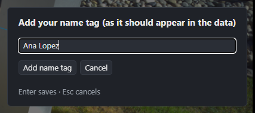

8. Press **Enter**. Your name now shows in the name box. The tool remembers it in this browser.
9. Pick an image with the image picker (top left), or press **n** for the next image. The picker lists **your
   assigned images** ([ASSIGNMENTS.md](ASSIGNMENTS.md)) in the order to annotate them: **VAL** and **TEST** images
   first, then **TRAIN** (section 4).
10. Press **m** (the pair type for a *material* pair).
11. Click once on a flat area of one surface: this places patch **A**.
12. Click once on a flat area of a *different* surface in the same light: this places patch **B**.
13. Look at the top right of the toolbar. It says **saved** and a time. Your pair is saved.
14. Look at the pair list on the right. Your pair is at the top, with your name.

If you place a pair by mistake, press **u** to undo it.

---

## 2. A tour of the screen

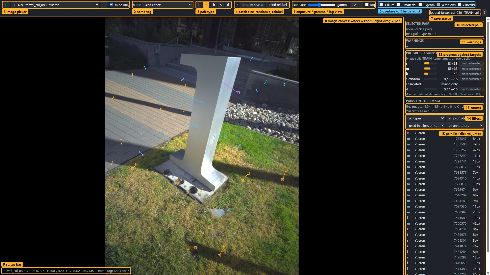

| # | Region | What it is for |
|---|---|---|
| 1 | Image picker | Choose the image. Each entry starts with the image's data split (VAL, TEST, TRAIN). The arrows (or **n** / **p**) go to the next / previous image. **mine only** (on by default) lists only the images assigned to your name tag. |
| 2 | Name tag | Who you are. Every pair you place carries this tag. You cannot place pairs without one. The menu also has **Add new…** and **Rename this tag…**. |
| 3 | Pair type | The type of the next pair: **i m b s d** (section 3). The highlighted one is active. |
| 4 | Patch size, random s, relabel | `r 4` is the size of new patches. **random s seed** starts a random s pair. **blind relabel** starts relabel mode (section 7). |
| 5 | Exposure / gamma / log view | Make dark areas visible. These only change the display, never the data. |
| 6 | Overlays | Lines drawn by a computer detector. **Off by default** (section 6). |
| 7 | Save status | "saved" and a time after every change. If it says anything else, read section 10. |
| 8 | Image canvas | Click to place patches. Mouse wheel zooms. Right-drag (or hold Space and drag) pans. **f** fits the image. |
| 9 | Status bar | Pixel position and value under the mouse, and what the tool expects next. |
| 10 | Selected pair | Details of the pair you clicked. |
| 11 | Warnings | Problems with the selected pair, or with the pair you are placing. |
| 12 | Progress | The image's data split, and how many pairs it has against the targets. **mark exhausted** per type (section 4). |
| 13 | Counts | Pairs per type on this image, and per annotator. |
| 14 | Filters | Show only some types, confidence levels, annotators, or pairs used (or not) by a training loss. |
| 15 | Pair list | Every pair on this image. Click one to jump to it. |

### Your name tag

Every pair stores your tag's fixed **id**, not the name itself. Every screen and every export shows the tag's current
name, so you can rename a tag at any time without touching a single pair.

To rename your tag (for example from **Annotator B** to your own name):

1. Pick your tag in the name box.
2. Open the name box again and pick **Rename this tag…**.
3. Type the new name and press **Enter**.

   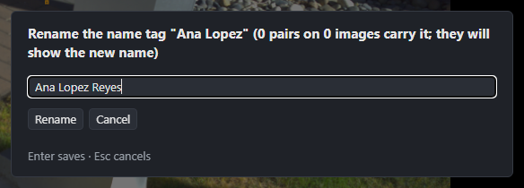

4. The tool says how many pairs carry the tag and asks you to confirm. Press **1** (or **Enter**).

The tool refuses an empty name and a name that another tag already has (capital letters do not count as different).
Renaming changes only `metrics/annotations/annotators.json`.

### Your images and other people's images

Each image is assigned to one annotator ([ASSIGNMENTS.md](ASSIGNMENTS.md)). With **mine only** ticked, the picker
lists only yours. If you open someone else's image (untick **mine only**, or use **n** / **p** past your own), the
tool warns you first:

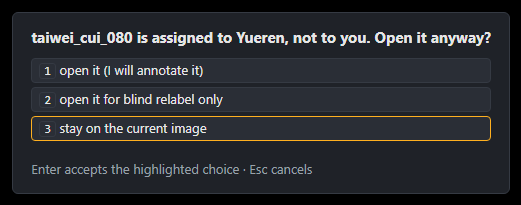

Press **1** to open it anyway, **2** to blind-relabel it (section 7), or **Esc** to stay where you are. Do not add
pairs to other people's images unless the project lead asks you to. Blind relabel mode never shows this warning.

### The canvas: patches and colours

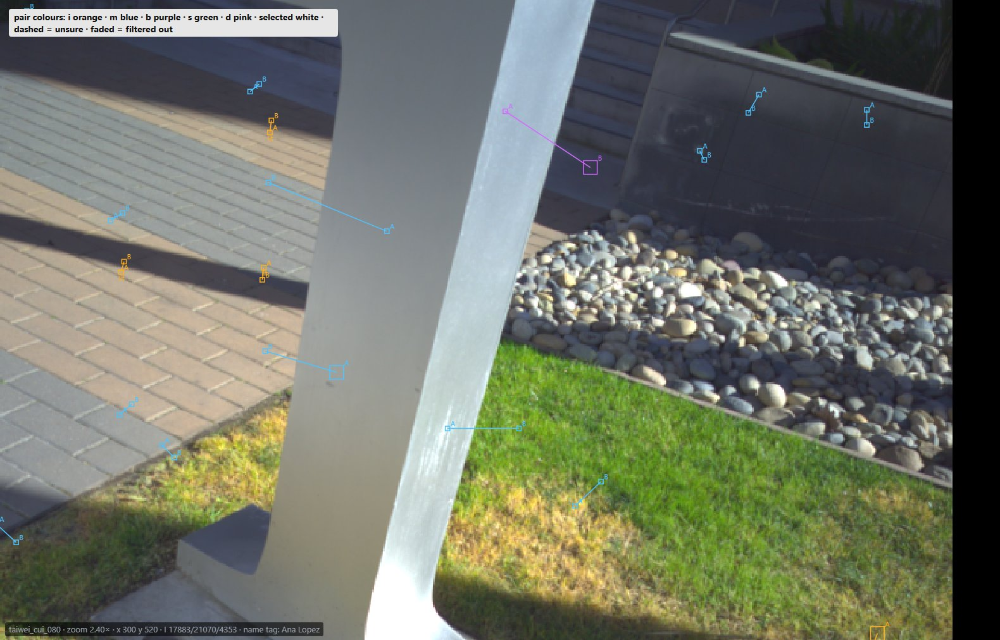

- Each patch is a small **square**. The tool takes the typical colour inside the square, so a few odd pixels do not
  matter. The square's size is set by **r**: a square is 2 × r + 1 pixels wide (r 4 = 9 × 9 pixels).
- A thin line joins **A** and **B**.
- Colours show the type: **i orange · m blue · b purple · s green · d pink**. The selected pair is white.
- A **dashed** pair is marked *unsure*.
- A **faded** pair is hidden by a filter.

### Warnings and the status bar

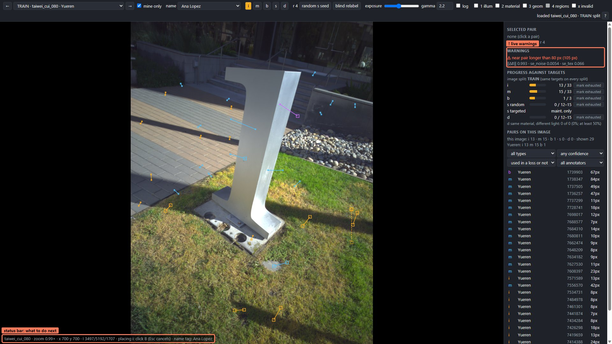

Warnings never stop you. They tell you something may be wrong:

- **longer than 80 px** for a near pair (i, m, b, s), or **shorter than 150 px** for a distant pair (d);
- **random s partner should be 20–80 px away**;
- **patch less than 70% valid**: part of the patch is overexposed (pure white) or has no signal;
- **low SNR**: the patch is too dark or noisy to measure well;
- **patch out of bounds**: the square runs off the image.

When you see a warning, move the patch or make it smaller (**[**), unless you have a good reason.

### Progress against targets

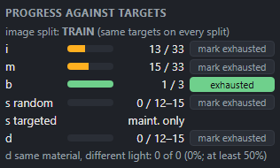

Each image has targets (section 4). A bar turns green when the target is reached, or when you mark the type
**exhausted** on that image.

### The pair list

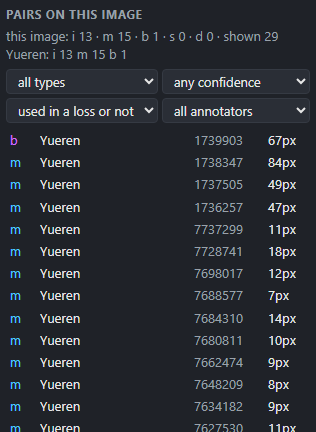

Click a row to jump to that pair. Use the filters to see, for example, only your own pairs.

### Dialogs

When a pair needs more information, a dialog asks for it. Answer with the number or letter key. **Enter** accepts
the highlighted choice, if there is one. **Esc** cancels (the pair is not placed).

| Dialog | When it appears |
|---|---|
| 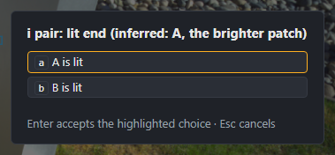 | After an **i** pair: which end is in the light. The tool pre-selects the brighter end. |
| 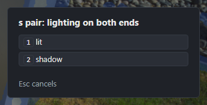 | After an **s** pair: are both ends lit or both in shadow. |
| 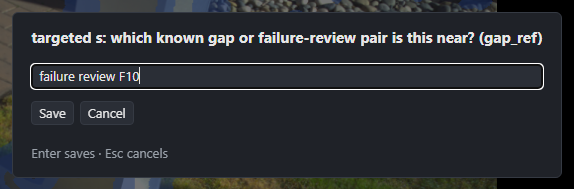 | After a **targeted s** pair (maintainer only): which known gap or problem spot it is near. |
|  | Opening an image assigned to another annotator (above). |
|  | **Rename this tag…** in the name box (above). |
| 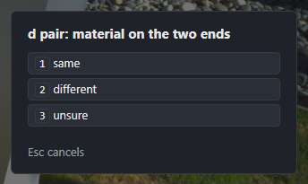 | After a **d** pair: same material at the two ends? |
| 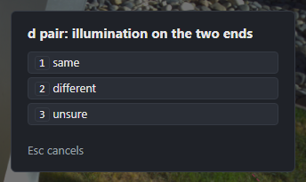 | After a **d** pair: same lighting at the two ends? |
| 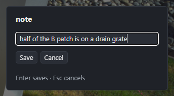 | **Shift+N** on a selected pair: a free-text note. |
| 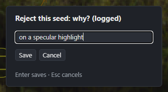 | **Delete** on a proposed random seed: why you reject it. |
| 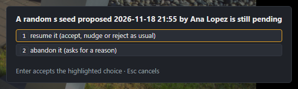 | Opening an image with a random seed still pending (from an earlier session): resume it or abandon it. |
| 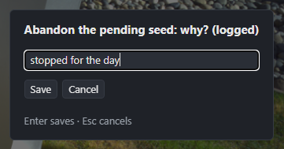 | Abandoning a seed (Esc on a seed, or after cancelling its partner): why. Every abandoned seed is logged with a reason. |
| 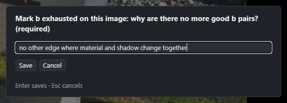 | **mark exhausted** in the progress panel: why there are no more good pairs of that type on this image. |
| 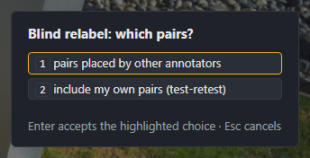 | **Shift+R**: start blind relabel mode (section 7). |
| 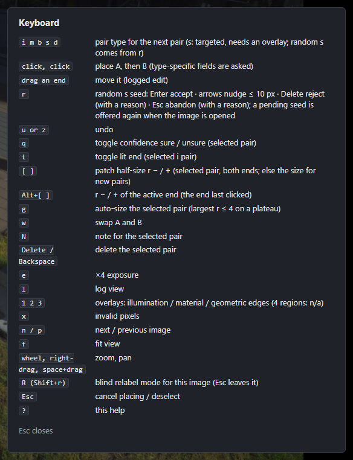 | **?**: all keys. |

If you have not chosen a name tag, the tool shows this and does nothing:

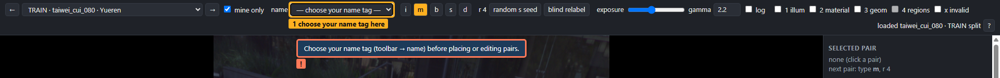

---

## 3. The pair types

Two words matter:

- **material**: what the surface is (grass, brick, painted metal, concrete);
- **light**: how much light falls on it (sun, shadow).

Each pair type is about which of the two changes between A and B. Every near pair (i, m, b, s) is short:
up to about 80 pixels.

**Rules for every pair:**

- Put each patch on a **flat, even** area of one surface.
- Keep both patches **clear of every edge**, at least a few pixels away.
- Do not put a patch on a **fine pattern** (mesh, gravel, small tiles, leaves), a **shiny highlight**, or an area
  that is **pure white or almost black**.
- An i, m or b pair crosses **exactly one** edge. An s pair crosses **no** edge.
- An m or s pair must not cross a **fold, corner or step** in the surface (for example where a wall meets the floor).

### i: illumination pair (one shadow edge, same material)

Same material on both sides, one end in light and one in shadow. Example: the same grass, half in the sun and half in
a shadow.

- **Do:** put one patch fully in the light and one fully in the shadow, well away from the soft shadow border.
- **Don't:** put a patch on the soft border of the shadow (where it fades from light to dark).

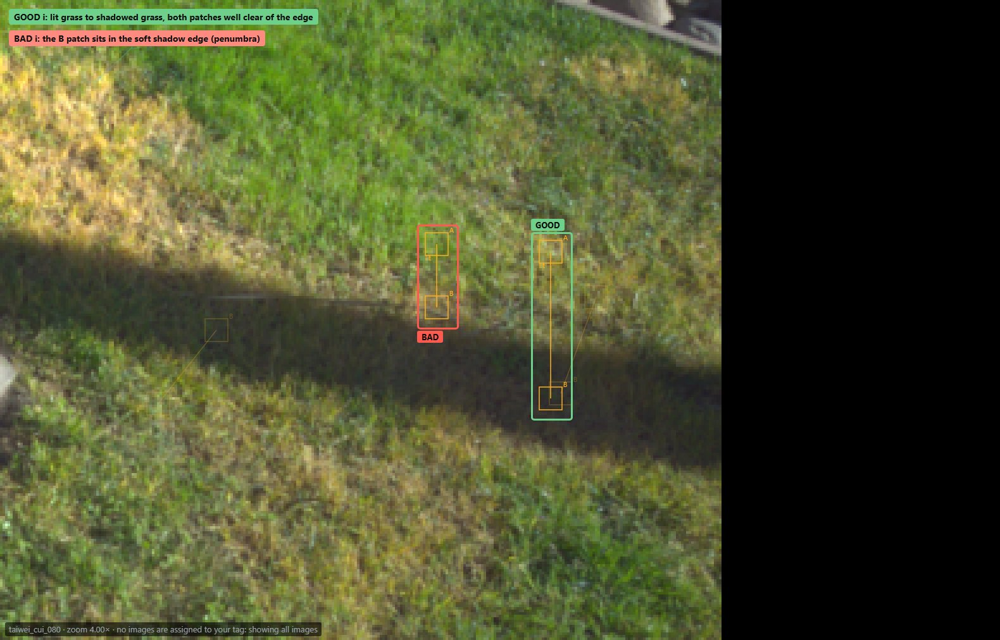

### m: material pair (one material edge, same light)

Different materials, the same light on both. Example: a stone slab next to grass, both in the sun.

- **Do:** both ends in the same light, each on one uniform material.
- **Don't:** let a patch touch the border between the two materials.

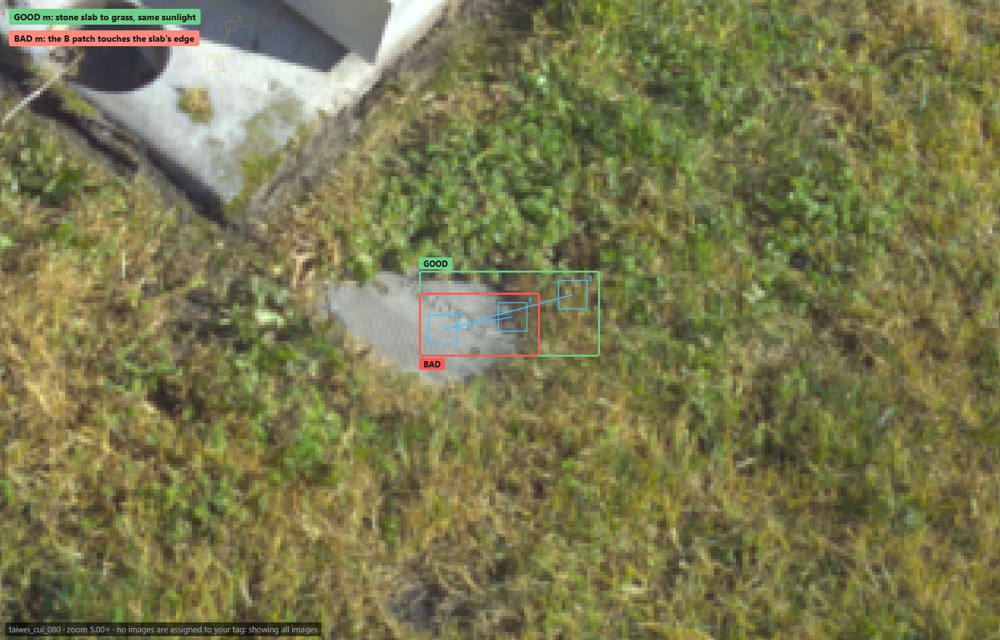

### b: both at once (one edge where material and light both change)

A shadow that starts exactly where a material starts. Example: a sunlit metal foot standing on grass that is in the
foot's own shadow.

- **Do:** use b only when **one** edge changes both material and light.
- **Don't:** use b when the shadow edge and the material edge are in **different places**. Make one m pair and one
  i pair instead.

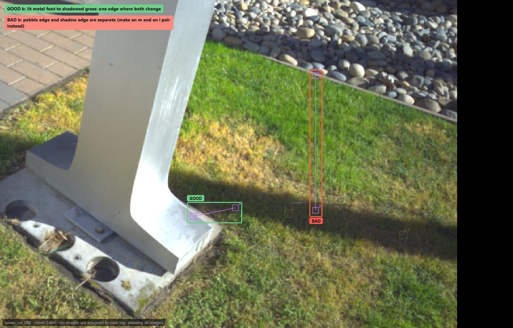

### s, random: no edge at all (the tool picks the spot)

Same material, same light, no edge between the ends. The tool proposes the first point, so these pairs are not
biased toward easy spots.

- **Do:** keep the partner 20–80 px away, on the same surface in the same light.
- **Don't:** cross a shadow edge or a material edge (that would be an i or an m pair).

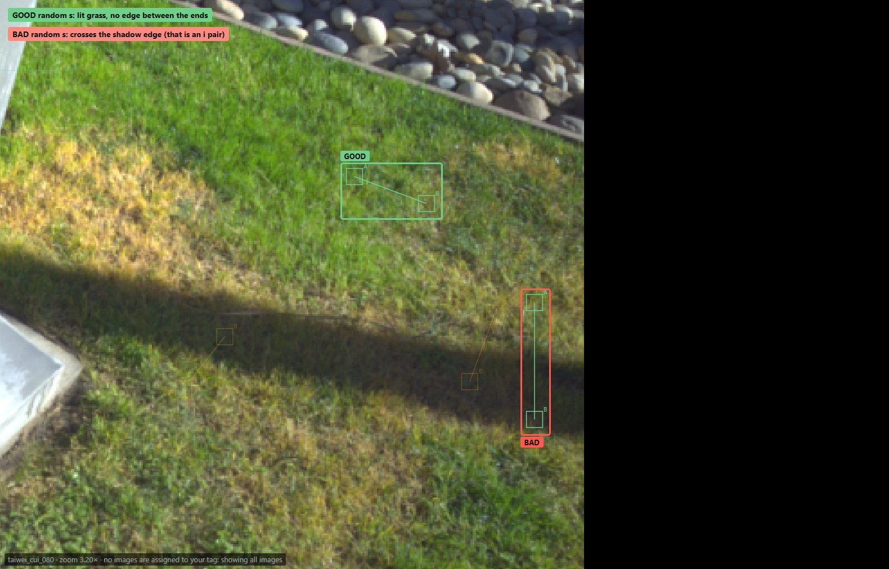

### s, targeted: no edge, placed on purpose near a known problem spot (maintainer only)

**Annotators skip this type.** The project lead adds targeted s pairs after your batch is merged. Without the overlay
maps the **s** type button is disabled, with a one-line explanation. For reference:

Same as random s, but you choose where. You place them near spots where the computer detector is known to miss a
shadow edge (a "gap"). You are told where these spots are (for example a list from a failure review). These are the
only pairs placed with an overlay on.

- **Do:** turn the illumination overlay on, and place pairs on one side of the edge, at several distances from the gap.
- **Don't:** cross the edge. A pair from light to light that crosses a narrow shadow stripe still crosses two edges.

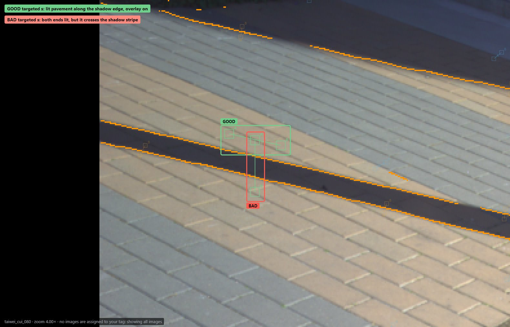

### d: distant pair

Two patches **far apart** (at least 150 px), anywhere in the image. You answer two questions: is the material the
same, and is the light the same?

- **Do:** mostly choose **the same material in different light** (for example sunlit grass and the same grass in
  shadow, far away). At least half of your d pairs should be like this.
- **Don't:** put a patch on a mix of materials (gravel, pebbles, leaves) or on two different surfaces.

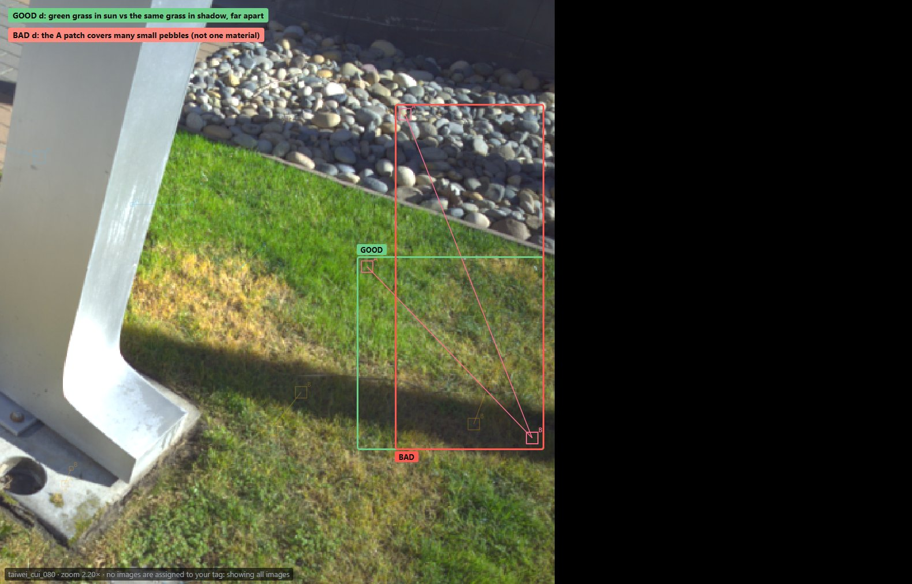

---

## 4. Working through one image

### Which images first

Every image belongs to one data split: **val** (20 images), **test** (20) or **train** (60). The image picker shows
it, and so does the progress panel. Every image gets every pair type, with the same targets, whatever its split.

1. Annotate the **val** and **test** images first. The image picker lists them first.
2. Then annotate the **train** images.

### Targets per image

| Type | Target per image | Notes |
|---|---|---|
| i | 33 | the typical (median) number on the first annotated images |
| m | 33 | the same |
| b | 3 | only where an edge really is both |
| random s | 12–15 | from the **random s seed** button only |
| targeted s | none for annotators | maintainer only (section 3) |
| d | 12–15 | at least half: same material, different light |

Targets are guidance, not quotas. Never add a doubtful pair to reach a number, and never go looking for far, fine
clutter to reach one. When an image has no more good pairs of a type:

1. Click **mark exhausted** next to that type in the progress panel.
2. Type a short reason (for example "no other shadow edges on flat surfaces").
3. Press **Enter**. The bar turns green: the target counts as met.

Click the button again to remove the mark.


### 4a. A fresh image (confirmation set)

1. **Look first.** Press **f** to see the whole image. Find the shadows, the materials and any shiny or overexposed
   areas. Press **x** to show invalid pixels (red), then **x** again to hide them.
2. **i pairs** (target about 37).
   1. Press **i**.
   2. Zoom in on a shadow edge (mouse wheel).
   3. Click A in the light, on one material.
   4. Click B in the shadow, on the same material.
   5. Check the lit end in the dialog and press **Enter**.
   6. Repeat along every shadow edge, on every material it crosses.
   - Common mistakes: a patch on the soft shadow border; the two ends on different materials; a patch on gravel, a
     mesh or leaves; a patch on a shiny highlight.
3. **m pairs** (target about 37).
   1. Press **m**.
   2. Click A on one material.
   3. Click B on the neighbouring material, in the same light.
   4. Repeat at every material edge, in the light and in the shadow.
   - Common mistakes: one end in shadow; crossing a fold or corner (a wall meeting the floor); a patch touching the
     material edge.
4. **b pairs** (target about 5).
   1. Press **b**.
   2. Find an edge where a shadow starts exactly at a material edge.
   3. Click A on the lit side and B on the shadowed side.
   - Common mistake: the shadow edge and the material edge are a few pixels apart. That is not a b pair.
5. **random s pairs** (target 12–15).
   1. Press **r** (or click **random s seed**). A yellow square appears with a circle around it.

      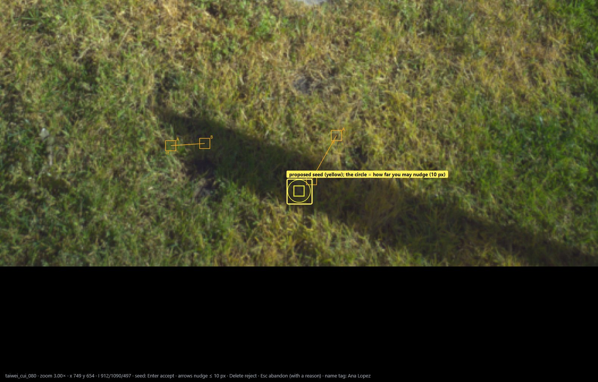

   2. Look at the proposed spot.
   3. If it is fine, press **Enter**. If it is slightly off (on a crack, at an edge), first move it with the arrow keys
      (at most 10 px, inside the circle), then press **Enter**.
   4. If it cannot work (pure white, on a highlight, on a mesh, on an edge), press **Delete**, type the reason, and
      press **Enter**. The rejection is saved.
   - If you press **Esc** on a seed, or cancel its partner, the tool asks why and logs the seed as abandoned.
   - If you leave an image with a seed still open, the tool offers it again the next time you open the image:
     **1** resume it, or **2** abandon it with a reason. A seed is never left hanging.
   5. After Enter, click the partner B, 20–80 px away, on the same surface in the same light, with no edge between.
   6. Answer the lighting question (1 lit, 2 shadow).
   - Common mistakes: moving the seed far (the circle limits it); crossing an edge with the partner.
6. **targeted s pairs**: skip. They are maintainer only (section 3); the progress panel shows them as *maint. only*.
7. **d pairs** (target 12–15).
   1. Press **d**.
   2. Click A on a uniform area.
   3. Click B far away (at least 150 px).
   4. Answer "material" (1 same, 2 different, 3 unsure).
   5. Answer "illumination" (1 same, 2 different, 3 unsure).
   - Aim: at least half with the same material in different light.
   - Common mistakes: a patch on a mix of materials; guessing instead of answering "unsure".
8. **Final check.**
   1. Look at the progress panel. Every bar should be green: reached, or marked exhausted with a reason.
   2. Use the type filter to show one type at a time, and scan the image for mistakes.
   3. Click any pair with a warning and fix it (drag an end, or **[** to make it smaller, or **g** to auto-size).
   4. Check that the save status says **saved**.

### 4b. An image that already has i, m and b pairs (the 46 older images)

1. **Look first** (as in 4a, step 1). Use the type filter to see the existing pairs.
2. **random s pairs**: as in 4a, step 5 (target 12–15).
3. **targeted s pairs**: skip (maintainer only).
4. **d pairs**: as in 4a, step 7 (target 12–15).
5. **i, m and b**: check the progress panel. If a type is below its target and good spots remain, add pairs as in
   4a, steps 2–4. If no good spots remain, mark the type exhausted.
6. **Final check**: as in 4a, step 8. Do not change other people's pairs. If one looks wrong, select it and add a
   note (**Shift+N**) instead.

---

## 5. Confidence and the d questions

- Every new pair starts as **sure**.
- Press **q** on a selected pair to mark it **unsure** (it is drawn dashed). Press **q** again to undo that.
- Mark a pair unsure when:
  - you are not certain the two ends are the same material (i pairs) or in the same light (m pairs);
  - the shadow is very faint;
  - the surface might be shiny or wet;
  - you cannot tell whether an edge is a shadow or a dark stain.
- Unsure pairs are kept, but they do not count in the main results. When in doubt, mark unsure rather than skip.
- For **d** pairs, answer each question on its own:
  - **material**: is it the same kind of surface at both ends (the same grass, the same painted wall)? Answer
    **unsure** if the two could be different (different bricks, different grass).
  - **illumination**: is the light the same at both ends (both in the sun, or both in the same kind of shadow)?
    Answer **unsure** if one end is in a soft or partial shadow.

---

## 6. Overlays

The overlays (**1** illumination edges, **2** material edges, **3** geometric edges) show what a computer detector
found. Region outlines (**4**) do not exist yet.

- **Overlays are a maintainer matter.** On an annotator's machine they normally do not exist, and every overlay
  button shows n/a. That is expected and nothing is missing for your work.
- **Keep them off** for every pair type except **targeted s** (maintainer only).
- Why: your pairs are used to check programs that learn from these detectors. If you place pairs where the detector
  drew lines, the check becomes circular: it would reward agreeing with the detector, not being right.
- The tool records whether an overlay was visible when each pair was placed.
- Maintainers build them or import them from an archive ([SETUP.md](SETUP.md), Part B). Without them, targeted s
  pairs cannot be placed (every other type works).
- For **targeted s** pairs an overlay is required. Their whole purpose is to test the places where the detector is
  known to be wrong.

---

## 7. Blind relabel mode

Use it when you are asked to check agreement: you label pairs that someone else placed, without seeing their labels.

1. Choose your name tag.
2. Open the image you were given.
3. Press **Shift+R** (or click **blind relabel**).
4. Choose **1** (pairs placed by others) or **2** (include your own, to check your own consistency).
5. The tool hides every other pair, the pair list and the overlays, and shows one pair in white.

   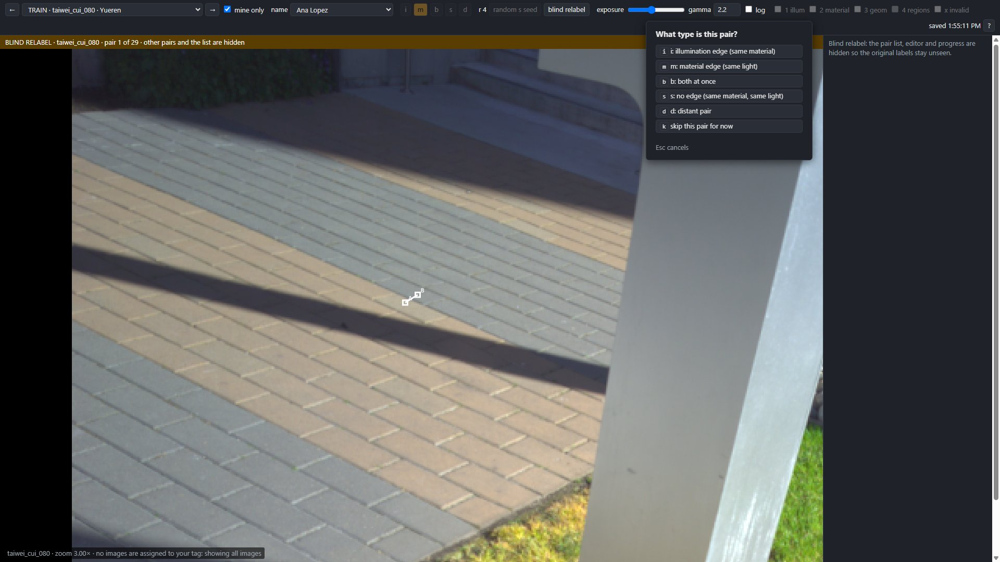

6. Zoom and pan as usual to look at it.
7. Press the type key (**i m b s d**), or **k** to skip it for now.
8. Answer the follow-up questions (lit end, lighting, or the two d questions).
9. Answer **1 sure** or **2 unsure**.
10. The next pair appears. Press **Esc** to stop at any time.

Your answers go to a separate relabel file. They never change the original pairs.

---

## 8. Keyboard shortcuts

| Key | Action |
|---|---|
| **i m b s d** | pair type for the next pair (s = targeted s: maintainer only, needs an overlay) |
| click, click | place A, then B |
| drag an end | move it |
| **r** | random s seed: **Enter** accept · arrows nudge (≤ 10 px) · **Delete** reject (with a reason) · **Esc** abandon (with a reason) |
| **u** or **z** | undo |
| **q** | sure / unsure (selected pair) |
| **t** | swap which end is lit (selected i pair) |
| **[** / **]** | smaller / larger patches (selected pair, or new pairs if none is selected) |
| **Alt+[** / **Alt+]** | smaller / larger patch at the end you last clicked |
| **g** | auto-size the selected pair (largest square up to r 4 that stays on flat, valid pixels) |
| **w** | swap A and B |
| **Shift+N** | note for the selected pair |
| **Delete** / **Backspace** | delete the selected pair (u undoes) |
| **e** | brighter view (×4 exposure) |
| **l** | log view (shows dark and bright areas together) |
| **1 2 3** | overlays: illumination / material / geometric edges |
| **x** | show invalid (overexposed or empty) pixels in red |
| **n** / **p** | next / previous image |
| **f** | fit the image |
| mouse wheel | zoom |
| right-drag, or Space + drag | pan |
| **Shift+R** | blind relabel mode (Esc leaves it) |
| **Esc** | cancel placing, or deselect |
| **?** | show all keys |

---

## 9. Saving, backups and merging

- **Every change saves itself** within a second. The status at the top right says **saved** and the time.
- Each image has one file: `metrics/annotations/<image>.json`.
- Before every save, the previous version is copied to `metrics/annotations/.backups/<image>/` with a time stamp.
- Deleted pairs are kept in the file (as "deleted"), so they can be recovered and are never brought back by a merge.
- Blind relabels are saved in `metrics/annotations/relabels/<image>.json`.

**Sending your work back** is done with git: commit only `metrics/annotations/`, push your branch, and open a pull
request when a batch is finished ([SETUP.md](SETUP.md), *Your session routine*).

**Merging two annotators' folders without git** (rarely needed):

1. Copy the other person's `annotations` folder somewhere, for example `~/from_ana/annotations`.
2. See what would change (nothing is written yet):

   ```
   python3 metrics/annotate/merge.py --from ~/from_ana/annotations
   ```

3. Read the report. **CONFLICT** lines mean the same pair was changed on both computers. The merge keeps your
   version and lists the other one, so you can decide.
4. Apply it:

   ```
   python3 metrics/annotate/merge.py --from ~/from_ana/annotations --apply
   ```

Old annotation files (from the earlier pair tool) were already converted. You do not need to do anything with them.

---

## 10. Troubleshooting

**I can't type my name in the "Add your name tag" dialog.**
Click inside the text box once, then type. If a password manager (1Password, LastPass, the browser's own) shows an icon
or a pop-up in the box, ignore it or press **Esc** on its pop-up only. The tool tells password managers to leave the
box alone. If your name still does not appear in the name box after **Enter**, the dialog shows the reason in red
(for example a name longer than 64 characters). If the dialog says it **could not reach the server**, the tool was
stopped: start it again (section 1, step 2).

**Clicking on the image does nothing.**
Choose your name tag first: the tool never places a pair without one. Also check that no dialog is open (press
**Esc**).

**Keys do nothing.**
A dialog may be open, or the cursor may be in a text box or drop-down. Press **Esc**, then click on the image once.

**The status says "conflict".**
The same image was changed in another browser tab or by someone else. Your last change was **not** saved. Reload the
page (**F5**) and redo it. Do not keep the same image open in two tabs.

**The status says "save rejected".**
The tool refused a change that would break the file. The red message says why. Undo (**u**) and try again. If it
keeps happening, tell the project lead.

**The page does not open.**
Check that the terminal still shows `annotation tool: http://127.0.0.1:8765/`. On Windows with WSL, open
`http://localhost:8765/` in the Windows browser.

**The s button is grey, or the overlays say n/a.**
Expected on an annotator's machine: overlays and targeted s pairs are maintainer only. Random s pairs use the
**random s seed** button, which always works.

**The image picker shows fewer images than I expected.**
**mine only** is ticked, so it lists only the images assigned to your tag. Check that the right tag is chosen in the
name box, and compare with [ASSIGNMENTS.md](ASSIGNMENTS.md).

**doctor says "file bytes differ but pixels match".**
Someone rated or tagged that image file (for example in Windows Explorer). The pixels are unchanged, so the tool still
accepts it. Do not do it again: rate, tag or edit no dataset image in any app.

**An image shows "loading…" for a long time.**
Its display files are missing. Stop the tool (**Ctrl+C**) and start it again with `metrics/annotate/run.sh`; it
prepares missing images first.

**A dialog says a random seed is "still pending".**
You (or someone) left the image with a seed open. Press **1** to resume it (then accept, nudge or reject it as usual),
or **2** to abandon it and type why.

**The tool refuses to prepare an image ("pixel SHA-256 ... Refusing").**
Your copy of the image has different pixels from the one the pairs were placed on. Get the original file; never annotate a
different copy.

**I placed a pair on the wrong image or with the wrong type.**
Press **u** right away. Later: select it and press **Delete**, then place it again.
