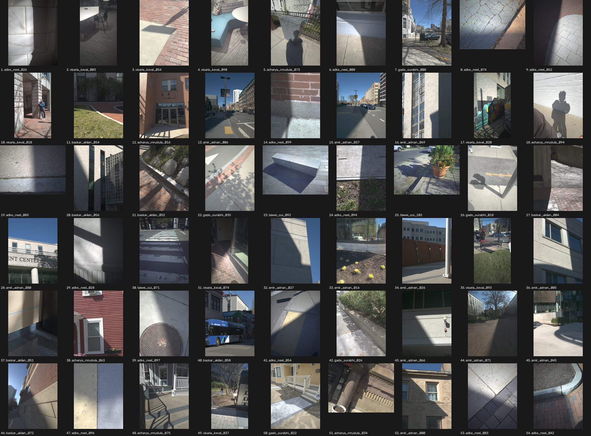

# Image assignments

Generated by `metrics/run.sh tools/assignments.py` from `metrics/splits/split100.json` and each image file's
`assigned_to`. Do not edit by hand. Annotate in this order: **val, then test, then train**.

*reflective (advisory)*: the image looked glossy or reflective on the contact sheet. Annotate it as usual; avoid
patches on shiny spots.

## Annotator B (tag id `annotator_b`): 54 images (val 11, test 11, train 32)

| # | image | split | reflective (advisory) |
|---|---|---|---|
| 1 | `acharya_mrudula_075` | val |  |
| 2 | `acharya_mrudula_094` | val |  |
| 3 | `adke_neel_052` | val |  |
| 4 | `adke_neel_074` | val |  |
| 5 | `amir_adnan_006` | val |  |
| 6 | `amir_adnan_016` | val | yes |
| 7 | `baskar_akilan_004` | val |  |
| 8 | `baskar_akilan_056` | val | yes |
| 9 | `gade_surabhi_008` | val |  |
| 10 | `visaria_keval_020` | val |  |
| 11 | `visaria_keval_074` | val | yes |
| 12 | `acharya_mrudula_016` | test | yes |
| 13 | `acharya_mrudula_034` | test |  |
| 14 | `acharya_mrudula_063` | test |  |
| 15 | `amir_adnan_026` | test |  |
| 16 | `baskar_akilan_052` | test |  |
| 17 | `baskar_akilan_058` | test |  |
| 18 | `gade_surabhi_018` | test |  |
| 19 | `gade_surabhi_022` | test |  |
| 20 | `gade_surabhi_026` | test |  |
| 21 | `gade_surabhi_035` | test |  |
| 22 | `taiwei_cui_092` | test |  |
| 23 | `acharya_mrudula_073` | train | yes |
| 24 | `adke_neel_008` | train |  |
| 25 | `adke_neel_026` | train | yes |
| 26 | `adke_neel_028` | train |  |
| 27 | `adke_neel_042` | train |  |
| 28 | `adke_neel_054` | train |  |
| 29 | `adke_neel_083` | train |  |
| 30 | `adke_neel_085` | train |  |
| 31 | `adke_neel_094` | train |  |
| 32 | `adke_neel_096` | train |  |
| 33 | `adke_neel_097` | train | yes |
| 34 | `adke_neel_099` | train |  |
| 35 | `amir_adnan_000` | train |  |
| 36 | `amir_adnan_005` | train |  |
| 37 | `amir_adnan_027` | train |  |
| 38 | `amir_adnan_037` | train |  |
| 39 | `amir_adnan_045` | train | yes |
| 40 | `amir_adnan_066` | train |  |
| 41 | `amir_adnan_069` | train | yes |
| 42 | `amir_adnan_071` | train |  |
| 43 | `amir_adnan_080` | train | yes |
| 44 | `baskar_akilan_051` | train |  |
| 45 | `baskar_akilan_054` | train |  |
| 46 | `baskar_akilan_072` | train |  |
| 47 | `taiwei_cui_071` | train |  |
| 48 | `taiwei_cui_102` | train |  |
| 49 | `visaria_keval_003` | train |  |
| 50 | `visaria_keval_018` | train | yes |
| 51 | `visaria_keval_037` | train |  |
| 52 | `visaria_keval_054` | train |  |
| 53 | `visaria_keval_090` | train |  |
| 54 | `visaria_keval_093` | train |  |

## Yueren (tag id `yueren`): 46 images (val 9, test 9, train 28)

| # | image | split | reflective (advisory) |
|---|---|---|---|
| 1 | `acharya_mrudula_101` | val |  |
| 2 | `acharya_mrudula_103` | val |  |
| 3 | `adke_neel_007` | val |  |
| 4 | `amir_adnan_044` | val |  |
| 5 | `baskar_akilan_013` | val |  |
| 6 | `gade_surabhi_046` | val |  |
| 7 | `taiwei_cui_070` | val |  |
| 8 | `taiwei_cui_090` | val |  |
| 9 | `visaria_keval_042` | val |  |
| 10 | `acharya_mrudula_039` | test |  |
| 11 | `acharya_mrudula_079` | test |  |
| 12 | `adke_neel_006` | test |  |
| 13 | `amir_adnan_023` | test |  |
| 14 | `baskar_akilan_005` | test |  |
| 15 | `gade_surabhi_013` | test |  |
| 16 | `taiwei_cui_084` | test |  |
| 17 | `visaria_keval_017` | test |  |
| 18 | `visaria_keval_036` | test |  |
| 19 | `acharya_mrudula_048` | train |  |
| 20 | `acharya_mrudula_072` | train |  |
| 21 | `acharya_mrudula_076` | train |  |
| 22 | `acharya_mrudula_112` | train |  |
| 23 | `acharya_mrudula_113` | train |  |
| 24 | `adke_neel_037` | train |  |
| 25 | `amir_adnan_096` | train |  |
| 26 | `baskar_akilan_030` | train |  |
| 27 | `baskar_akilan_047` | train |  |
| 28 | `baskar_akilan_068` | train |  |
| 29 | `baskar_akilan_076` | train |  |
| 30 | `baskar_akilan_099` | train |  |
| 31 | `gade_surabhi_003` | train |  |
| 32 | `taiwei_cui_075` | train |  |
| 33 | `taiwei_cui_076` | train |  |
| 34 | `taiwei_cui_079` | train |  |
| 35 | `taiwei_cui_080` | train |  |
| 36 | `taiwei_cui_082` | train |  |
| 37 | `taiwei_cui_083` | train |  |
| 38 | `taiwei_cui_088` | train |  |
| 39 | `taiwei_cui_089` | train |  |
| 40 | `taiwei_cui_097` | train |  |
| 41 | `taiwei_cui_100` | train |  |
| 42 | `taiwei_cui_105` | train |  |
| 43 | `visaria_keval_025` | train |  |
| 44 | `visaria_keval_069` | train |  |
| 45 | `visaria_keval_076` | train |  |
| 46 | `visaria_keval_094` | train |  |

## Contact sheet of the 54 drawn images

Numbers are the draw ranks (`metrics/splits/draw54.json`).

